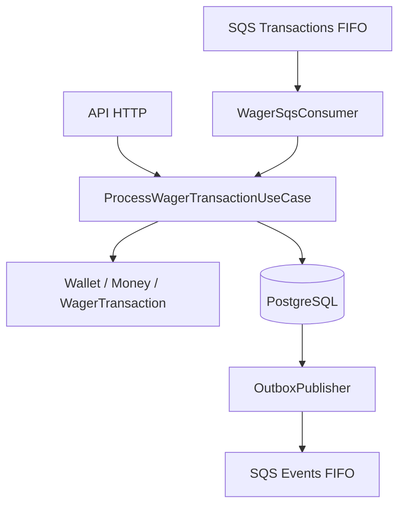

# Distributed Wagering Processor

**Desafio técnico Back-end — Jungle Gaming**

Processador financeiro distribuído para operações de apostas, desenvolvido com **Bun, TypeScript, NestJS, PostgreSQL, MikroORM, Decimal.js e AWS SQS (MiniStack)**.

O projeto foi construído com foco em **consistência financeira, concorrência distribuída, idempotência persistente, integridade do ledger, processamento assíncrono, recuperação após falhas e observabilidade**.

## 1. Visão geral

O Distributed Wagering Processor recebe operações financeiras enviadas por provedores de jogos através de dois canais:

- API HTTP REST;
- Mensagens AWS SQS FIFO.

Ambos utilizam o mesmo caso de uso financeiro, evitando divergências nas regras de negócio entre os transportes.

O PostgreSQL é a autoridade do estado financeiro. Locks transacionais, constraints, Inbox e Outbox garantem que múltiplas instâncias possam trabalhar sobre os mesmos dados sem depender de locks locais em memória.

### Principais funcionalidades

- Criação e consulta de carteiras;
- Processamento de BET, WIN, LOSS, REFUND e ROLLBACK;
- Abertura interna de carteiras com lançamento OPENING;
- Valores monetários decimais exatos;
- Bloqueio de saldo negativo;
- Idempotência persistente por identidade da transação;
- Controle de concorrência entre processos;
- Ledger financeiro append-only;
- Transactional Inbox e Outbox;
- Reprocessamento de referências recebidas fora de ordem;
- Retry e Dead Letter Queue (DLQ);
- Reconciliação financeira;
- Health checks e métricas compatíveis com Prometheus;
- Logs HTTP JSON com identificadores de correlação;
- Encerramento gracioso dos workers e do consumidor SQS.

## 2. Tecnologias

| Tecnologia | Utilização |
|---|---|
| Bun 1.4.4 | Runtime, dependências e execução de testes |
| TypeScript | Linguagem da aplicação |
| NestJS | API HTTP, validação, DI e ciclo de vida |
| PostgreSQL 17 | Persistência e integridade financeira |
| MikroORM 7 | ORM, transações, mapeamento e migrations |
| Decimal.js | Aritmética monetária exata |
| AWS SDK v3 | Integração com SQS |
| MiniStack | Emulador AWS SQS local |
| Docker Compose | Infraestrutura de desenvolvimento e validação |
| Bun Test | Testes unitários e de integração |
| class-validator | Validação dos contratos HTTP |

## 3. Arquitetura

A solução segue uma arquitetura modular com separação entre:

- **Domain:** entidades, agregados, objetos de valor e regras financeiras;
- **Application:** casos de uso, consultas e orquestração;
- **Infrastructure:** MikroORM, PostgreSQL, SQS, Inbox, Outbox e workers;
- **Presentation:** controllers, DTOs, filtros HTTP e interceptors.

### Fluxo principal



A operação financeira e a criação dos eventos na Outbox participam da mesma transação PostgreSQL.

A publicação dos eventos é realizada depois, por um worker independente do fluxo de commit.

As decisões arquiteturais e os trade-offs estão detalhados em [ARCHITECTURE.md](./ARCHITECTURE.md).

## 4. Estrutura do projeto

```text
distributed-wagering-processor/
├── src/
│   ├── application/
│   │   ├── queries/
│   │   ├── services/
│   │   └── use-cases/
│   ├── domain/
│   │   ├── entities/
│   │   ├── events/
│   │   └── value-objects/
│   ├── infrastructure/
│   │   ├── mappers/
│   │   ├── messaging/
│   │   ├── observability/
│   │   ├── persistence/
│   │   └── workers/
│   ├── migrations/
│   ├── presentation/
│   │   └── http/
│   ├── app.module.ts
│   ├── main.ts
│   └── mikro-orm.config.ts
├── scripts/
│   ├── audit-db-schema.ts
│   ├── migrate.ts
│   ├── setup-sqs.ts
│   ├── verify-clean.ps1
│   ├── verify-migration-rollback.ts
│   └── verify-sigterm.ps1
├── test/
│   ├── integration/
│   └── unit/
├── docker-compose.yaml
├── docker-compose.verify.yml
├── Dockerfile.sigterm
├── .dockerignore
├── .env.example
├── .gitignore
├── bun.lock
├── package.json
├── README.md
└── ARCHITECTURE.md
```

## 5. Pré-requisitos

Para executar localmente:

- Bun 1.4.4 ou versão compatível;
- Docker Desktop e Docker Compose;
- Git;
- PowerShell para os scripts de verificação.

A aplicação foi validada em Windows com infraestrutura Docker. O encerramento por `SIGTERM` também foi verificado em Linux.

## 6. Instalação e execução

### 6.1. Obter o projeto

```bash
git clone <URL_DO_REPOSITORIO>
cd distributed-wagering-processor
```

Substitua `<URL_DO_REPOSITORIO>` pelo endereço do repositório publicado.

### 6.2. Instalar as dependências

```bash
bun install --frozen-lockfile
```

O lockfile `bun.lock` permite reproduzir as dependências utilizadas na validação.

### 6.3. Configurar o ambiente

No PowerShell:

```powershell
Copy-Item .env.example .env
```

Variáveis utilizadas no ambiente local:

```dotenv
NODE_ENV=development
PORT=3000

DB_HOST=127.0.0.1
DB_PORT=5433
DB_USER=wagering_user
DB_PASSWORD=wagering_dev_password
DB_NAME=wagering_db

AWS_REGION=us-east-1
AWS_ACCESS_KEY_ID=test
AWS_SECRET_ACCESS_KEY=test
SQS_ENDPOINT=http://127.0.0.1:4566

PENDING_REFERENCE_WORKER_ENABLED=true
OUTBOX_PUBLISHER_ENABLED=true
WAGER_SQS_CONSUMER_ENABLED=true

METRICS_TOKEN=substitua-por-um-token-local
```

A senha acima é demonstrativa e corresponde à configuração do PostgreSQL de desenvolvimento no `docker-compose.yaml`.

As credenciais AWS `test` são utilizadas somente com o emulador MiniStack.

**Não publique o `.env` com informações privadas.**

### 6.4. Iniciar PostgreSQL e MiniStack

```bash
docker compose up -d
```

Confira:

```bash
docker compose ps
```

Serviços da configuração local:

| Serviço | Endereço |
|---|---|
| PostgreSQL | `127.0.0.1:5433` |
| MiniStack SQS | `127.0.0.1:4566` |
| API NestJS | `127.0.0.1:3000` |

### 6.5. Aplicar migrations

```bash
bun run scripts/migrate.ts
```

A estrutura é criada por três migrations versionadas:

```text
Migration202611120001
Migration202611130002
Migration202611130003
```

Essas migrations foram validadas em um banco vazio e testadas com reversão e reaplicação.

### 6.6. Criar as filas SQS

```bash
bun run scripts/setup-sqs.ts
```

Filas utilizadas:

```text
wager-transactions.fifo
wager-transactions-dlq.fifo
wager-events.fifo
wager-events-dlq.fifo
```

A configuração local utiliza política de redrive para DLQ após tentativas de entrega sem sucesso.

### 6.7. Compilar

```bash
bun run build
```

### 6.8. Iniciar a aplicação

```bash
bun run start:prod
```

Esse script executa a aplicação compilada com Bun.

Também é possível executar diretamente:

```bash
bun dist/main.js
```

Por padrão, a aplicação estará disponível em:

```text
http://localhost:3000
```

Os workers podem ser habilitados ou desabilitados pelas variáveis de ambiente correspondentes.

## 7. Health checks

### Liveness

```http
GET /health/live
```

Verifica se o processo HTTP está ativo.

### Readiness

```http
GET /health/ready
```

Verifica a comunicação com PostgreSQL e SQS.

Exemplos:

```powershell
Invoke-RestMethod http://localhost:3000/health/live
Invoke-RestMethod http://localhost:3000/health/ready
```

Os endpoints de saúde não exigem autenticação.

## 8. Modelo financeiro

### Money

Dinheiro é representado como valor decimal exato.

```json
{
  "amount": "100.00",
  "currency": "BRL"
}
```

O Value Object `Money` utiliza Decimal.js.

As operações monetárias respeitam:

- Escala decimal de duas casas;
- Validação de moeda;
- Imutabilidade;
- Compatibilidade de moedas;
- Limites do tipo persistido;
- Rejeição de valores inválidos.

A persistência utiliza `NUMERIC` no PostgreSQL.

### Wallet

A carteira é responsável pelo saldo financeiro.

Principais invariantes:

- Saldo nunca negativo;
- Movimentações na moeda da carteira;
- Versão da carteira para acompanhar alterações;
- Lançamento de ledger correspondente a alterações de saldo;
- Unicidade por jogador e moeda.

### WagerTransaction

Operações suportadas:

| Operação | Efeito sobre o saldo |
|---|---|
| OPENING | Crédito inicial, somente interno |
| BET | Débito |
| WIN | Crédito |
| LOSS | Nenhuma alteração |
| REFUND | Reversão integral de uma BET |
| ROLLBACK | Efeito inverso da transação referenciada |

Estados:

```text
PENDING
PENDING_REFERENCE
PROCESSED
REJECTED
FAILED
```

Os estados `PROCESSED`, `REJECTED` e `FAILED` são terminais.

## 9. API HTTP

### Endpoints disponíveis

| Método | Rota | Finalidade |
|---|---|---|
| POST | `/wallets` | Criar carteira |
| GET | `/wallets/:walletId` | Consultar carteira |
| GET | `/wallets/:walletId/ledger` | Consultar ledger paginado |
| POST | `/wallets/:walletId/reconciliation` | Reconciliar saldo |
| GET | `/wallets/:walletId/reconciliation` | Consulta de reconciliação legada |
| POST | `/wagering/transactions` | Processar operação financeira |
| GET | `/wagering/transactions/:transactionId` | Consultar transação interna |
| GET | `/providers/:providerId/wagering/transactions/:externalTransactionId` | Consultar transação externa |
| GET | `/health/live` | Liveness |
| GET | `/health/ready` | Readiness |
| GET | `/metrics` | Métricas operacionais |

### 9.1. Criar carteira

Requisição:

```http
POST /wallets
Content-Type: application/json
```

Corpo:

```json
{
  "playerId": "c930fe3e-a4e2-4726-842a-48169ab5c985",
  "initialBalance": {
    "amount": "100.00",
    "currency": "BRL"
  }
}
```

Resposta ilustrativa:

```json
{
  "id": "0f9c0ea6-69d2-4e64-bf65-073c4db8600a",
  "playerId": "c930fe3e-a4e2-4726-842a-48169ab5c985",
  "balance": {
    "amount": "100.00",
    "currency": "BRL"
  },
  "version": 1
}
```

Uma abertura com saldo positivo registra uma transação interna `OPENING` e um lançamento no ledger.

### 9.2. Processar BET

Requisição:

```http
POST /wagering/transactions
Content-Type: application/json
Idempotency-Key: provider-a:bet-123
```

Corpo:

```json
{
  "providerId": "provider-a",
  "externalTransactionId": "bet-123",
  "playerId": "c930fe3e-a4e2-4726-842a-48169ab5c985",
  "walletId": "0f9c0ea6-69d2-4e64-bf65-073c4db8600a",
  "roundId": "round-001",
  "gameId": "game-001",
  "kind": "BET",
  "money": {
    "amount": "25.00",
    "currency": "BRL"
  }
}
```

Resposta ilustrativa:

```json
{
  "transactionId": "4b2407e3-6979-4b18-a8b7-04bbab03a956",
  "status": "PROCESSED",
  "balance": {
    "amount": "75.00",
    "currency": "BRL"
  },
  "idempotentReplay": false
}
```

Se a mesma requisição for reenviada com o mesmo conteúdo e identidade, o resultado original será recuperado sem novo débito:

```json
{
  "transactionId": "4b2407e3-6979-4b18-a8b7-04bbab03a956",
  "status": "PROCESSED",
  "balance": {
    "amount": "75.00",
    "currency": "BRL"
  },
  "idempotentReplay": true
}
```

Uma mesma identidade com payload de negócio divergente produz conflito.

### 9.3. REFUND e ROLLBACK

Essas operações informam a referência por meio de:

```json
{
  "referenceExternalTransactionId": "bet-123"
}
```

O campo é incluído junto dos demais campos da operação financeira.

Se a referência ainda não estiver disponível, a operação poderá permanecer em `PENDING_REFERENCE`, sem alterar o saldo, para posterior resolução.

### 9.4. Status HTTP

| Situação | Código |
|---|---|
| Operação processada | 200 |
| Carteira criada | 201 |
| Operação pendente | 202 |
| Payload inválido | 400 |
| Recurso não encontrado | 404 |
| Conflito de idempotência | 409 |
| Rejeição por regra de negócio | 422 |
| Falha transitória representada como indisponibilidade | 503 |

O processamento distingue erros de validação, conflitos de identidade e falhas internas.

Os testes adicionais verificam que BET de valor zero, carteira de outro jogador e moeda incompatível retornam `422` sem modificar o saldo.

### 9.5. Consulta do ledger

```http
GET /wallets/:walletId/ledger?limit=20
```

A paginação utiliza cursor:

```http
GET /wallets/:walletId/ledger?limit=20&cursor=CURSOR_RECEBIDO
```

O contrato retorna:

```json
{
  "items": [],
  "nextCursor": null,
  "hasMore": false
}
```

Cada item contém a transação, direção, valor, moeda, saldo anterior, saldo posterior e data do lançamento.

O parâmetro `limit` aceita valores entre 1 e 100.

### 9.6. Reconciliação

```http
POST /wallets/:walletId/reconciliation
```

Resposta ilustrativa:

```json
{
  "walletId": "0f9c0ea6-69d2-4e64-bf65-073c4db8600a",
  "storedBalance": {
    "amount": "75.00",
    "currency": "BRL"
  },
  "calculatedBalance": {
    "amount": "75.00",
    "currency": "BRL"
  },
  "difference": {
    "amount": "0.00",
    "currency": "BRL"
  },
  "consistent": true,
  "checkedEntries": 2
}
```

A reconciliação compara o saldo materializado com a soma dos lançamentos do ledger, usando aritmética `NUMERIC` no PostgreSQL.

Divergências são informadas, sem correção automática silenciosa.

## 10. Concorrência e idempotência

### Concorrência financeira

A carteira é a unidade de serialização das alterações de saldo.

A implementação combina:

- Locks transacionais de identidade;
- Lock pessimista na carteira;
- Constraints de unicidade;
- Transações SQL atômicas.

### Exemplo validado

Saldo inicial:

```text
100.00 BRL
```

Duas apostas simultâneas:

```text
BET A = 80.00 BRL
BET B = 80.00 BRL
```

Resultado:

```text
Uma operação PROCESSED
Uma operação REJECTED

Saldo final: 20.00 BRL
Débitos registrados: 1
```

### Carteiras independentes

O projeto possui um teste específico que mantém a carteira A bloqueada no PostgreSQL e verifica que uma transação da carteira B consegue terminar antes da liberação de A.

Isso confirma que não existe um lock global bloqueando todas as carteiras.

### Idempotência HTTP

O header `Idempotency-Key` é obrigatório.

O banco possui unicidade global da chave e também da identidade:

```text
providerId + externalTransactionId
```

O hash do payload de negócio utiliza uma representação canônica e SHA-256.

A recomendação é incluir um namespace na chave de idempotência:

```text
providerId:externalTransactionId
```

### Idempotência SQS

O consumidor utiliza uma Inbox persistente com a identidade:

```text
consumerName + messageId
```

O registro da Inbox participa da mesma transação SQL que o processamento financeiro.

A deduplicação temporária do SQS FIFO não é utilizada como única garantia financeira.

## 11. Ledger financeiro

Toda alteração efetiva de saldo possui um lançamento correspondente no ledger.

O ledger contém:

- Carteira;
- Transação;
- Direção `DEBIT` ou `CREDIT`;
- Valor;
- Moeda;
- Saldo anterior;
- Saldo posterior;
- Data.

O ledger é append-only.

No PostgreSQL, o trigger `ledger_immutable_trigger` impede operações de `UPDATE` e `DELETE`.

Também existem constraints para validar:

- Valor positivo;
- Saldos não negativos;
- Aritmética de débito e crédito;
- Uma entrada por transação financeira.

Essas regras foram verificadas em testes de integração diretamente no banco.

## 12. Transactional Inbox e Outbox

### Transactional Inbox

A Inbox impede que a mesma entrega SQS produza novamente um efeito financeiro.

O registro da entrega e as alterações financeiras são confirmados na mesma transação PostgreSQL.

Se ocorrer rollback, a Inbox também será revertida.

### Transactional Outbox

A Outbox registra eventos antes do commit financeiro.

O OutboxPublisher publica eventos pendentes posteriormente no SQS.

O publisher utiliza:

```sql
FOR UPDATE SKIP LOCKED
```

para coordenar instâncias concorrentes.

Em caso de falha, registra uma nova tentativa com agendamento e backoff.

**A entrega é at-least-once.**

Se o SQS aceitar um evento e a confirmação se perder, ele poderá ser reenviado. Consumidores externos devem suportar idempotência.

## 13. Mensageria SQS

O consumidor utiliza mensagens do tipo:

```text
WagerTransactionRequested
```

Envelope ilustrativo:

```json
{
  "messageId": "msg-123",
  "type": "WagerTransactionRequested",
  "occurredAt": "2026-11-13T15:00:00.000Z",
  "data": {
    "providerId": "provider-a",
    "externalTransactionId": "bet-123",
    "idempotencyKey": "provider-a:bet-123",
    "walletId": "0f9c0ea6-69d2-4e64-bf65-073c4db8600a",
    "playerId": "c930fe3e-a4e2-4726-842a-48169ab5c985",
    "roundId": "round-001",
    "gameId": "game-001",
    "kind": "BET",
    "money": {
      "amount": "25.00",
      "currency": "BRL"
    }
  }
}
```

Comportamento:

- Validação do envelope;
- Reutilização do caso de uso financeiro;
- Inbox transacional;
- ACK após commit;
- Retry em falhas transitórias;
- Tratamento terminal para determinados erros de validação;
- Redrive para DLQ após repetidas falhas.

As filas FIFO ajudam na ordenação por grupo, mas a integridade financeira é garantida pelo PostgreSQL.

## 14. Referências fora de ordem

REFUND e ROLLBACK podem chegar antes da transação referenciada.

Nesses casos, uma operação pode assumir:

```text
PENDING_REFERENCE
```

O `PendingReferenceWorker` procura transações pendentes e tenta resolver a referência posteriormente.

A implementação utiliza:

- Processamento periódico;
- Backoff;
- Limite de tentativas;
- Prazo de expiração;
- Lotes e concorrência controlados.

A operação pendente não altera antecipadamente o saldo.

## 15. Observabilidade

### Logs

As requisições HTTP utilizam `X-Correlation-Id`.

Um identificador válido recebido é preservado. Na ausência de valor válido, um UUID é gerado.

Os logs HTTP são JSON e incluem os campos disponíveis:

- `correlationId`;
- `transactionId`;
- `walletId`;
- `providerId`;
- Método e rota;
- Status HTTP final;
- Duração;
- Nome da exceção.

Os workers também registram eventos estruturados.

A correlação distribuída completa entre HTTP, SQS e Outbox permanece como evolução futura.

### Métricas

```http
GET /metrics
```

O endpoint fornece métricas em formato compatível com Prometheus.

Inclui:

- Transações persistidas por tipo e status;
- Replays idempotentes HTTP;
- Conflitos SQL propagados;
- Latência de requisições;
- Registros da Inbox;
- Eventos pendentes na Outbox;
- Tentativas adicionais da Outbox;
- Idade dos eventos pendentes;
- Atraso médio de publicação;
- Contagens aproximadas nas DLQs;
- Reconciliações e divergências.

Métricas consultadas do banco e SQS representam estado compartilhado. Contadores HTTP em memória são locais à instância.

### Proteção das métricas

Configure `METRICS_TOKEN` e envie:

```http
Authorization: Bearer SEU_TOKEN
```

Em ambiente de produção, o endpoint não disponibiliza métricas sem token configurado.

## 16. Encerramento gracioso

O NestJS utiliza:

```typescript
app.enableShutdownHooks();
```

Os workers interrompem novos ciclos e aguardam os ciclos iniciados.

O serviço SQS mantém o cliente ativo durante o encerramento dos workers.

Mensagens recebidas e ainda não confirmadas podem ter sua visibilidade liberada com:

```text
VisibilityTimeout = 0
```

O cliente SQS é encerrado após o processamento dos hooks.

### Validação realizada

Foi executado um teste de integração que confirmou a reentrega de uma mensagem não reconhecida após o shutdown.

Também foi executada uma aplicação real em container Linux, com:

- Readiness aprovado;
- Envio real de `SIGTERM`;
- Encerramento dos três workers;
- Finalização do SQS sem falhas de liberação;
- Código de saída 0.

O teste de `SIGTERM` não interrompeu intencionalmente uma transação financeira no meio do commit.

## 17. Testes automatizados

O projeto utiliza Bun Test.

Execute:

```bash
bun run test
```

Ou diretamente:

```bash
bun test ./test
```

### Cobertura de cenários

**Testes de domínio**

- Aritmética monetária exata;
- Imutabilidade;
- Regras da carteira;
- Estados de transações;
- Reversões e validações.

**Testes PostgreSQL**

- Constraints;
- Ledger imutável;
- Concorrência;
- Atomicidade;
- Reconciliação;
- Recuperação após falha.

**Testes SQS**

- Inbox e Outbox;
- Retry e DLQ;
- Reentrega segura;
- Publicação concorrente;
- Encerramento gracioso.

**Testes HTTP**

- Contratos de API;
- Criação de carteira;
- Idempotência;
- Status de processamento;
- Validação de entradas;
- Correlação HTTP;
- Métricas;
- Reconciliação.

**Testes distribuídos**

- Três processos Bun;
- Cinquenta solicitações idênticas;
- Duas BETs disputando saldo;
- Carteiras distintas processando independentemente;
- Falha simulada após commit.

### Última execução validada

Em 13/11/2026:

```text
86 pass
0 fail
500 expect() calls
Ran 86 tests across 23 files
```

## 18. Validação em infraestrutura limpa

Execute:

```powershell
powershell -NoProfile -ExecutionPolicy Bypass -File .\scripts\verify-clean.ps1
```

O script cria uma infraestrutura Docker isolada utilizando:

```text
PostgreSQL: 127.0.0.1:5543
MiniStack:  127.0.0.1:5566
```

Ele executa:

1. Instalação das dependências pelo lockfile;
2. Criação de PostgreSQL e MiniStack limpos;
3. Aplicação das migrations;
4. Criação das filas SQS;
5. Build NestJS;
6. Execução de todos os testes;
7. Remoção da infraestrutura temporária.

Resultado confirmado:

```text
VALIDATION SUCCESSFUL

Dependencies: OK
Fresh PostgreSQL: OK
Database migrations: OK
SQS queues: OK
TypeScript build: OK
Test suite: OK

86 pass
0 fail
500 expect() calls
```

A infraestrutura principal de desenvolvimento não é removida.

## 19. Verificação de migrations

Execute:

```bash
bun run scripts/verify-migration-rollback.ts
```

O script cria um banco local temporário e testa:

```text
UP   -> aplica 3 migrations
DOWN -> reverte 3 migrations
UP   -> reaplica 3 migrations
```

Também confere a criação e a remoção das tabelas financeiras.

Resultado confirmado:

```text
MIGRATION VERIFICATION SUCCESSFUL

Initial UP: OK
Individual DOWN: OK
Schema cleanup: OK
Second UP: OK
Original development database: UNCHANGED
```

O banco temporário é removido ao final.

Essa validação requer permissão para criar e excluir bancos no PostgreSQL local.

## 20. Verificação de SIGTERM

Execute:

```powershell
powershell -NoProfile -ExecutionPolicy Bypass -File .\scripts\verify-sigterm.ps1
```

O script:

1. Compila uma imagem Linux da aplicação;
2. Inicializa um container temporário;
3. Confirma o readiness HTTP;
4. Envia `SIGTERM` pelo Docker;
5. Verifica os logs de encerramento;
6. Confere o código de saída;
7. Remove o container de teste.

Resultado confirmado:

```text
SIGTERM VERIFICATION SUCCESSFUL

Linux container: OK
Application readiness: OK
SIGTERM delivered: OK
SQS shutdown hook: OK
SQS release failures: 0
Container exit code: 0
```

**Atenção:** essa verificação utiliza o banco e o SQS de desenvolvimento configurados no `.env`. Se os workers estiverem habilitados, eles podem processar operações pendentes. Utilize infraestrutura descartável para novas execuções, evitando efeitos colaterais.

## 21. Segurança

A autenticação externa dos provedores não foi implementada nesta versão.

Para um ambiente de produção, a arquitetura recomenda integração com um Identity Provider OIDC, como Keycloak ou Zitadel, com autenticação e autorização por provedor.

A identidade do provedor deve ser obtida de uma credencial validada, e não confiada exclusivamente ao corpo da requisição.

O endpoint de métricas utiliza token configurável.

Os endpoints financeiros não devem ser expostos publicamente sem autenticação e autorização adequadas.

## 22. Limitações conhecidas

- Autenticação OIDC não implementada;
- Contadores HTTP em memória não agregados entre instâncias;
- Correlação distribuída ponta a ponta ainda não demonstrada por teste específico;
- Publicação da Outbox com garantia at-least-once, permitindo duplicatas;
- Teste de SIGTERM sem interrupção intencional durante um commit;
- Testes com múltiplos processos Bun, sem implantação de três réplicas Docker da aplicação;
- Sem benchmark formal de throughput e percentis de latência;
- Sem dashboard externo de monitoramento.

Essas limitações delimitam o escopo validado e não substituem as garantias financeiras verificadas.

## 23. Documentação complementar

Consulte [ARCHITECTURE.md](./ARCHITECTURE.md) para os detalhes sobre:

- Decisões arquiteturais;
- Invariantes financeiras;
- Concorrência;
- Idempotência;
- Ledger;
- Inbox e Outbox;
- Recuperação após falhas;
- Trade-offs;
- Limitações e evoluções futuras.

## 24. Referência

Desafio técnico:

[Jungle Gaming — Backend Challenge](https://github.com/junglegaming/backend-challenge)

O princípio central da implementação é que **reentregas, concorrência e falhas transitórias não devem provocar efeitos financeiros duplicados nem saldos inválidos**.
